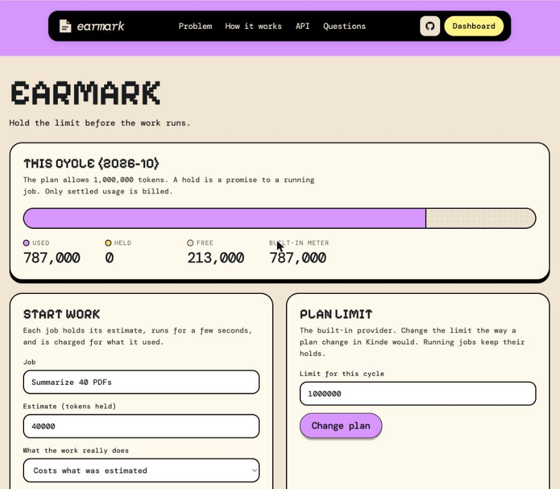
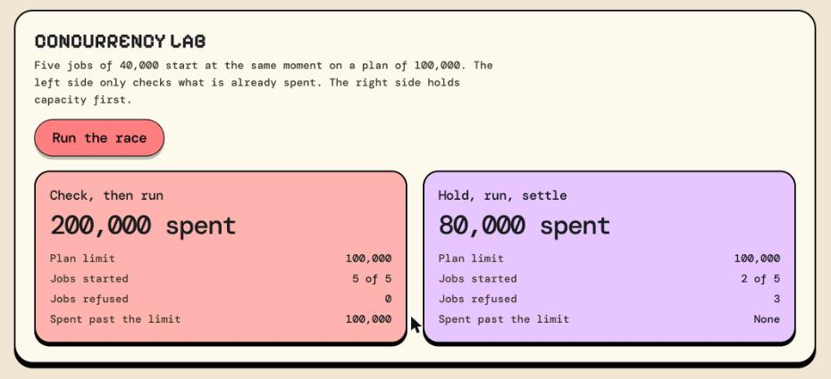
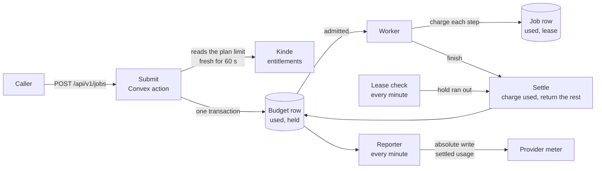
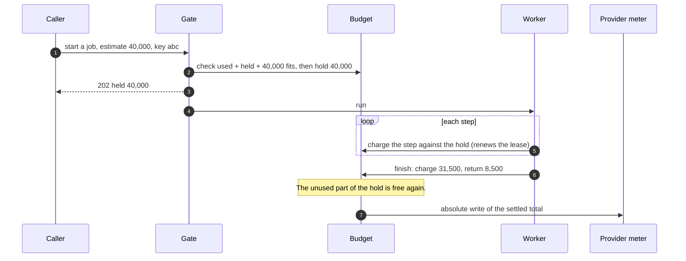

<p align="center">
  
</p>

<h1 align="center">Earmark</h1>

<p align="center">
  Hold the limit before the work runs.<br>
  A job holds part of the customer's limit before it starts, stops at what it holds, and pays for what it used.
</p>

<p align="center">
  <a href="LICENSE"></a>
  
  
  
  
</p>

## What Earmark is

Earmark is a gate for work that costs usage: a model call, a render, a long export. Before a job starts, it checks that the job's estimate fits inside what is left of the customer's plan limit, and holds that amount. While the job runs, every step is charged against the hold, so the hold is also the most the job can spend. When the job ends, it pays for what it used and the rest of the hold goes back.

It is built to show one production problem: **how to stop concurrent jobs from spending the same limit twice**, when the work takes minutes and the usage is only counted when it ends.

Earmark is a Next.js app (App Router) with a Convex backend. Kinde provides sign-in, the plan limit (read from the customer's entitlements) and the usage meter. The work in the demo is simulated, so you can run it with no model key and break it on purpose.

## What it looks like

The dashboard shows what is used, what is held and what is free. A hold is a promise to a running job, and only settled usage is billed.



The Concurrency Lab starts five jobs of 40,000 at the same moment on a plan of 100,000. Without a hold, all five start and 200,000 is spent. With a hold, two start, three are refused and 80,000 is spent.



## The problem

A customer has a plan of 100,000 tokens a month. Five jobs of 40,000 start at the same moment. Each one checks the account, sees 100,000 left, and runs. The customer spends 200,000.

Four things go wrong when a limit is only checked at the start:

1. Every concurrent job passes the check, because none of them is counted yet.
2. A job costs more than its estimate, and nothing stops it.
3. A job fails halfway. Charging nothing gives the work away, and charging the estimate bills for work that did not happen.
4. A worker disappears in the middle of a job, and whatever was set aside for it stays set aside.

## Features

- **One check and one hold.** In a single transaction, Earmark checks that the whole estimate fits in what is left, and holds it. Used and held are both counted, so two jobs are never promised the same capacity.
- **A hold that is also a cap.** The worker charges each step against the hold before the next step starts. A step that would pass the hold is cut short and the job stops.
- **Settlement at the real cost.** A job that ends is charged for what it used, and the rest of the hold goes back. A failed job pays for the work it did.
- **Leases.** Every charge renews the hold. A worker that disappears loses its hold when the lease runs out, and the job is settled at what it used.
- **Refusals with a reason.** A job that does not fit gets a 402 with the amount left, and holds nothing.
- **Safe to repeat.** A job has a key. The same key returns the same job and holds nothing twice, so a retry is harmless.
- **The plan limit from Kinde.** Earmark reads the maximum for the feature from the customer's entitlements, keeps it for a minute, and uses the last known limit for ten minutes if Kinde cannot be read. After that it refuses new work.
- **Usage reported as a total.** Only settled usage goes to the meter, as an absolute write. A hold is a promise and is never sent as usage.
- **A Concurrency Lab.** One button starts five jobs at the same moment with and without a hold, and shows what each one spent.

## Architecture



There are four parts.

1. **The gate** (`convex/gate.ts`, `convex/lib/core.ts`). It reads the limit, checks the whole estimate against used and held, and takes the hold in one transaction.
2. **The worker** (`convex/work.ts`). It charges each step against the hold and ends the job. A real worker follows the same shape.
3. **Settlement and leases** (`convex/lib/jobs.ts`, `convex/gate.ts`). A job pays for what it used and returns the rest. A job whose lease ran out is settled the same way.
4. **The reporter** (`convex/report.ts`). It sends each changed total to the provider and marks a failed one again.

### How a job is counted



## Decisions and the reasons for them

- **The check and the hold are one transaction.** If they were two calls, two jobs could both read the same remaining amount before either one wrote its hold. Convex runs a transaction as if no other one ran at the same time, so the second job sees the first job's hold.
- **The estimate is the hold, and the hold is the cap.** A job cannot spend past what it was promised, so a wrong estimate costs the customer at most the estimate.
- **A refused job holds nothing.** It gets a row for the log and a reason, and the capacity stays free.
- **A job settles once.** Settling a job that is not running does nothing, so a late or repeated finish cannot charge twice.
- **A lease, not a lock.** A hold lasts two minutes without a charge. Every charge renews it. A worker that stops cannot keep capacity forever, and a worker that returns late cannot spend, because its job was already settled.
- **A conflict is retried.** Many jobs at once all touch the same budget row. A conflict is retried with a random, growing wait. The retry is safe because admission is keyed and settling happens once.
- **A job is settled in the cycle it was admitted in.** If the month changes while a job runs, its hold and its charge stay in the cycle it started in.
- **Fail closed.** If the plan limit cannot be read and the last known limit is older than ten minutes, new work is refused. Spending past a limit that may have changed is the worse mistake.
- **Only settled usage is reported, as a total.** The reporter sets the meter with an absolute write, so a repeat changes nothing, and a failed report is marked again.

## Run it on your machine

You need Node.js 22 or later and a Convex account.

```bash
git clone https://github.com/sholajegede/earmark.git
cd earmark
npm install
npx convex dev
```

In a second terminal:

```bash
npm run setup
npm run dev
```

`npm run setup` makes a server key and stores it in `.env.local` and on your Convex deployment. With no Kinde settings, Earmark runs with a local account and a built-in stand-in for the plan limit and the meter. Open `http://localhost:3000/app`, then press **Run the race** in the Concurrency Lab.

## Configuration

Copy `.env.example` to `.env.local`. Every value is described there.

| Variable | Where | What it does |
| --- | --- | --- |
| `NEXT_PUBLIC_CONVEX_URL` | `.env.local` | Your Convex deployment. `npx convex dev` fills it in. |
| `EARMARK_SERVER_KEY` | `.env.local` and Convex | Lets the website, and nothing else, call the Convex functions. |
| `KINDE_CLIENT_ID`, `KINDE_CLIENT_SECRET`, `KINDE_ISSUER_URL` | `.env.local` | Kinde sign-in. Without them, a local account is used outside production. |
| `PROVIDER` | `.env.local` and Convex | `kinde` reads the limit from Kinde and reports usage to it. Empty uses the built-in stand-in. |
| `KINDE_DOMAIN`, `KINDE_M2M_CLIENT_ID`, `KINDE_M2M_CLIENT_SECRET` | Convex | A machine-to-machine app with the `read:billing_entitlements` and `create:meter_usage` scopes. |

## API

Start a job. The estimate is held before the job runs.

```bash
curl -X POST http://localhost:3000/api/v1/jobs \
  -H "Authorization: Bearer local-dev" \
  -H "Idempotency-Key: report-2026-10-21" \
  -H "content-type: application/json" \
  -d '{"label":"Summarize 40 PDFs","estimate":40000}'
```

- **202** `{"admitted":true,"held":40000,"remaining":60000}`: the job is running.
- **402** `{"admitted":false,"reason":"The job needs 40,000 and 20,000 is left (...)","remaining":20000}`: nothing was held.
- **200** with `"duplicate":true`: the key was used before, so this is the same job and nothing new was held.

The built-in worker accepts a `simulate` object so you can break a job on purpose: `{"actual":60000,"step_ms":400,"fail_after":20000}` or `"crash_after"`.

| Route | What it does |
| --- | --- |
| `POST /api/v1/jobs` | Hold and start a job. |
| `GET /api/v1/overview` | The limit, what is used and held, the latest jobs and settlements. |
| `PATCH /api/v1/billing` | Built-in provider: change the plan limit by hand. |
| `POST /api/v1/billing` | Kinde: set the billing customer, the agreement, and the agreement start (UTC). |
| `POST /api/v1/lab` | The Concurrency Lab: `{"mode":"naive"}` or `{"mode":"earmark"}`. |

## Read the limit and report usage with Kinde

Set `PROVIDER=kinde` in `.env.local` and on Convex, then set the Kinde values from the table above. In the dashboard, enter the Kinde billing customer id and the agreement id, and the agreement start in UTC before the first job.

Earmark reads the limit with `GET /api/v1/billing/entitlements?customer_id=...` and reports usage with `POST /api/v1/billing/meter_usage` and `meter_type_code: absolute`.

### What is verified and what is not

Verified in this repository's tests, with a fake Kinde:

- the limit is read, kept for a minute, and the last known limit is used for ten minutes when Kinde is down
- a failed report is marked again and the newest total is sent next time
- the usage write is an absolute write with the agreement, the feature code and the total

Verified against a real Kinde account when this was built (in the Notch project, which uses the same endpoint): an absolute write sets the total and can be repeated, and a delta write adds.

From Kinde's documentation, and not yet confirmed here on a real account:

- the entitlements endpoint, its `read:billing_entitlements` scope, and the `entitlement_limit_max` field
- that a null maximum is returned as the `max_value` you send
- that Kinde reports the limit and does not enforce it, so the app must stop the work. The documentation does not say that Kinde blocks usage past a limit.
- how soon a plan change shows in the entitlements

## Tests

```bash
npm test
npm run typecheck
npm run lint
```

49 tests run with `convex-test` and no network. They cover:

| File | What it checks |
| --- | --- |
| `tests/core.test.ts` | The pure rules: the gate, charging, settling, which limit to trust, reading Kinde's entitlements, billing cycles and conflict retries |
| `tests/flow.test.ts` | The whole loop: concurrent admission, refusal, caps, failed jobs, leases and late workers, plan changes, the Kinde limit and outage, cycle changes, reports and the lab |

The concurrency tests run five jobs of 40,000 against a limit of 100,000. With a hold, two start, three are refused and 80,000 is spent. Without a hold, all five start and 200,000 is spent.

## Load run

To measure your own deployment:

```bash
node scripts/load.mjs --jobs 120 --estimate 1000 --limit 100000 --concurrency 50
```

It sends 120 jobs of 1,000 at 50 at a time against a limit of 100,000, waits for them to end, and checks that no more than 100,000 was spent and that nothing is still held. With a fresh account, exactly 100 jobs start and 20 are refused. An account can start 120 jobs a minute, so a larger run is refused by that rate limit, not by the usage limit.

A run on a laptop against a Convex cloud development deployment, 120 jobs of 1,000 at 50 at a time, with room for exactly 100:

| Result | Value |
| --- | --- |
| Started / refused / failed | 100 / 20 / 0 |
| Spent | 100,000 of the 100,000 that was free |
| Still held after the run | 0 |
| Rate | 18 requests a second |
| Time to start a job | median 1,316 ms, 95th percentile 3,717 ms, 99th percentile 5,099 ms |

These numbers come from one laptop and one deployment. They show that the limit holds under concurrency, not what a production host will do.

## Deploy

1. Deploy Convex: `npx convex deploy`, then set `EARMARK_SERVER_KEY` (and the Kinde values if you use Kinde) on the production deployment.
2. Deploy the website to Vercel and set the same variables in the project settings.
3. In Kinde, add the production URL as a callback and logout URL.

## Project layout

| Path | What is in it |
| --- | --- |
| `convex/lib/core.ts` | The pure rules |
| `convex/gate.ts` | Admission, spending, finishing, lease expiry, the dashboard query |
| `convex/work.ts` | The built-in worker |
| `convex/lib/jobs.ts` | Settlement |
| `convex/report.ts` | The reporter |
| `convex/lib/provider.ts` | Kinde: the limit and the meter |
| `convex/lab.ts` | The Concurrency Lab |
| `src/app/api/v1/` | The HTTP API |
| `src/components/dashboard.tsx` | The dashboard |
| `tests/` | The tests |

## Limits

- **One budget row for each account and cycle.** Every admission and every settlement writes it, so one account's jobs queue behind each other at very high rates. Conflicts are retried. This suits expensive work, which starts at a few jobs a second, and does not suit a hot path of thousands a second.
- **The work in the demo is simulated.** A real worker must charge as it goes, and stop when a charge says the hold is used up. Earmark cannot stop work that does not report its cost.
- **The estimate is the cap.** A job that needs more than its estimate is stopped, not extended.
- **The lease is two minutes.** A live worker must charge at least that often.
- **Earmark does not prove the meter.** It decides whether work may start and what it was charged. Proving that the provider's meter matches what was charged is a separate job.
- **One provider.** The limit and the meter are read from Kinde. Another provider needs two small functions in `convex/lib/provider.ts`.

## Contributing

Bug reports and pull requests are welcome. Read [CONTRIBUTING.md](CONTRIBUTING.md) first. For a security problem, read [SECURITY.md](SECURITY.md).

## Licence

MIT. See [LICENSE](LICENSE).
